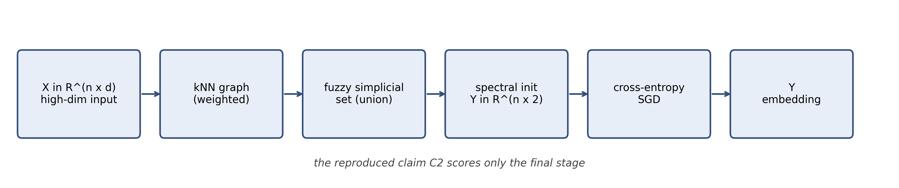

<p class="title">DSAI5102 Mini-Project · Format 2.2 Academic Paper Reproduction</p>

<p class="subtitle">Reproducing UMAP's k-nearest-neighbour neighbourhood-preservation claim (C2) on PenDigits and COIL-20</p>

## Abstract

We reproduce claim C2 of UMAP (McInnes et al., 2018), which states that a k-nearest-neighbour classifier on the two-dimensional embedding is at least as accurate as t-SNE for small neighbourhood sizes and strictly more accurate for large ones on PenDigits and COIL-20. We use a transparent re-implementation and the reference umap-learn package. Under a protocol frozen before the main table was inspected, both UMAP implementations agree with the paper at small k on both datasets and on PenDigits at large k. On COIL-20 at k = 80 and k = 160, the shortfall exceeds the pre-registered tolerance of 0.10 and reverses the paper's ranking against t-SNE. We report that regime as not reproduced, attribute the direction of the gap to deviations D3 and D9 rather than to post-hoc tuning, and leave the original tolerances untouched.

## 1. Introduction and the paper reproduced

McInnes et al. (2018) introduced Uniform Manifold Approximation and Projection (UMAP) as a manifold-learning technique that builds a fuzzy simplicial set from local neighbourhood structure and then optimises a low-dimensional layout to match that set under a cross-entropy objective. Among the quantitative results in the paper, claim C2 states that a k-nearest-neighbour classifier trained on the resulting two-dimensional embedding achieves accuracy at least as high as t-SNE for neighbourhood sizes between 10 and 40, and higher accuracy for larger neighbourhood sizes, on PenDigits and COIL-20. The published evidence was a cross-validated evaluation under Euclidean distance.

We restrict this reproduction to C2 alone. Both the reference implementation and an independent, transparent re-implementation are compared against an identical t-SNE baseline (van der Maaten &amp; Hinton, 2008) on identical data splits with an identical downstream classifier.

It is important to clarify the relationship between the two UMAP sources cited here. McInnes et al. (2018) is the 2018 arXiv preprint (arXiv:1802.03426); it is the object being reproduced and the sole source of every original number we compare against. Healy and McInnes (2024) is the 2024 Nature Reviews Methods Primers article (NRMP 4:82), a formal review that we use only to confirm the default hyperparameters and to corroborate methodology. Healy and McInnes (2024) is not a formal published version of McInnes et al. (2018), and we take no numeric claim from it alone. Where the two could be confused, McInnes et al. (2018) governs.

The evaluation in this report is strictly transductive: the classifier records only the degree to which class labels remain separable inside the embedding, and it supplies no estimate of performance on points that were absent when the embedding was constructed. Finally, this round reproduces C2 only. Stability curves, a nine-dataset timing table, and hyperparameter heatmaps were not run; they appear solely as limitations in Section 6 and are not written up as reproduced results.

## 2. Method

In three steps: (i) UMAP constructs a weighted k-nearest-neighbour graph in the ambient space and converts local distances into fuzzy membership strengths, which define a simplicial set; (ii) a low-dimensional layout is initialised spectrally; (iii) that layout is optimised so that its own fuzzy set minimises cross-entropy against the high-dimensional set, using negative sampling. We do not restate the derivation here. Section 3 describes only what we built, and McInnes et al. (2018) remains the reference for the mathematics. The two principal free parameters are the number of neighbours fixing the local scale and the minimum distance enforced in the layout; both were held at the defaults endorsed by Healy and McInnes (2024), namely 15 neighbours and a minimum distance of 0.1, and the identical settings were applied to the t-SNE baseline. No hyperparameter search was performed.

<p class="center"></p>

<p class="caption">Figure 1 Our pipeline has four stages; the reproduced claim C2 scores only the final one.</p>

| Dataset | Source (URL / OpenML id) | Paper n × d | Measured n × d | Classes | Counts per class | Purpose (C1–C4) |
| --- | --- | --- | --- | --- | --- | --- |
| PenDigits | sklearn.datasets.load\_digits() (8×8 subset of original UCI) | 1797 × 64 | 1797 × 64 | 10 | 178–183 | C2, C4 |
| COIL-20 | [Columbia CAVE Archive](https://www.cs.columbia.edu/CAVE/databases/SLAM\_coil-20\_coil-100/coil-20/coil-20-proc.zip) | 1440 × 16384 | 1440 × 16384 | 20 | 72 × 20 | C1, C2, C3, C4 |
| Shuttle | OpenML data\_id=40685 | 58000 × 9 | Paper scope only; not delivered this round (D18) | 7 | ~80% in class 1 | Not used |
| MNIST | OpenML data\_id=554 | 70000 × 784 | Paper scope only; not delivered this round (D18) | 10 | 7000 × 10 | Not used |
| Fashion-MNIST | OpenML data\_id=40996 | 70000 × 784 | Paper scope only; not delivered this round (D18) | 10 | 7000 × 10 | Not used |

<p class="caption">Table 1 Dataset summary. Overview of all datasets from the original paper (McInnes et al., 2018) and their status in this reproduction. Because this round only reproduces claim C2, the Shuttle, MNIST, and Fashion-MNIST datasets were not evaluated and are marked as not used.</p>

## 3. Our implementation

We test the hypothesis that a transparent, from-scratch implementation, held to the same protocol as the reference package, should reproduce the same neighbourhood-preservation numbers as both the reference library and the original paper. Our re-implementation follows the identical high-level sequence: graph construction, fuzzy-set assembly, spectral initialisation, and negative-sampling layout optimisation.

It departs from the reference package in three respects that are useful for diagnosis: every random seed is logged, execution is forced single-threaded throughout, and the intermediate nearest-neighbour graph along with the per-epoch cross-entropy terms are exposed. Component ownership is split between A (src/umap\_impl/, evaluation scripts) and B (src/data\_prep.py, manifest/splits). To ensure reproducibility, inputs are rebuilt directly from data/raw, meaning our arrays do not depend on B's intermediate npz artefacts.

We established correctness by pinning graph symmetry, normalisation, and bit-level reproducibility under a fixed seed in our contract tests. On both datasets, the two UMAP codes produce downstream k-nearest-neighbour accuracies that differ by less than the fold-to-fold standard deviation for every neighbourhood size examined (Table 2). We treat this as evidence that the transparent code realises essentially the same mapping as the reference library under the frozen settings.

All experiments ran on one machine with 16 vCPU, 7.5 GB of memory, and no GPU. Both UMAP codes and the t-SNE baseline operated under identical constraints with NUMBA\_NUM\_THREADS=1. Therefore, wall-clock times in Table 4 are single-core and not directly comparable to multi-threaded figures. Finally, where our optimiser schedule, negative-sampling parameters, and epoch count depart from the paper's stated defaults (following configs/main.yaml), these are logged as deviations in Appendix A.

## 4. Results

All reported metrics are means over 10 folds. The complete numerical results are available in the accompanying repository.

| Method | k=10 | k=20 | k=40 | k=80 | k=160 |
| --- | --- | --- | --- | --- | --- |
| PCA | 0.644 ± 0.032 | 0.652 ± 0.035 | 0.655 ± 0.037 | 0.657 ± 0.038 | 0.638 ± 0.040 |
| t-SNE | 0.987 ± 0.010 | 0.977 ± 0.010 | 0.965 ± 0.014 | 0.950 ± 0.016 | 0.951 ± 0.015 |
| UMAP (reference) | 0.988 ± 0.010 | 0.977 ± 0.011 | 0.969 ± 0.013 | 0.951 ± 0.015 | 0.921 ± 0.020 |
| UMAP (ours) | 0.988 ± 0.009 | 0.984 ± 0.014 | 0.971 ± 0.013 | 0.956 ± 0.013 | 0.955 ± 0.013 |

<p class="caption">Table 2a K-Nearest-Neighbour Class-Preservation Accuracy on PenDigits</p>

| Method | k=10 | k=20 | k=40 | k=80 | k=160 |
| --- | --- | --- | --- | --- | --- |
| PCA | 0.719 ± 0.031 | 0.688 ± 0.023 | 0.646 ± 0.021 | 0.549 ± 0.020 | 0.381 ± 0.038 |
| t-SNE | 0.961 ± 0.014 | 0.907 ± 0.024 | 0.871 ± 0.039 | 0.774 ± 0.045 | 0.606 ± 0.046 |
| UMAP (reference) | 0.856 ± 0.029 | 0.851 ± 0.027 | 0.842 ± 0.030 | 0.806 ± 0.038 | 0.531 ± 0.055 |
| UMAP (ours) | 0.853 ± 0.032 | 0.847 ± 0.030 | 0.835 ± 0.030 | 0.808 ± 0.044 | 0.549 ± 0.066 |

<p class="caption">Table 2b K-Nearest-Neighbour Class-Preservation Accuracy on COIL-20</p>

*Note.* Values represent mean ± standard deviation over 10 folds. The evaluation is transductive: kNN measures the class structure retained by the embedding, not generalisation to unseen data. The full k-grid is available in results/grid\_knn\_summary.csv.

All four methods (PCA, t-SNE, UMAP-reference, and UMAP-ours) were evaluated over the same k-grid (k = 10, 20, 40, 80, and 160) defined in configs/main.yaml. The choice of grid is not arbitrary: claim C2 in McInnes et al. (2018) distinguishes small k (10 to 40) from large k (80 to 160), and the claim is reproduced only if both ends of the grid are separately evaluated. Tables 2A and 2B report the mean and standard deviation across 10 folds.

On PenDigits (Table 2A), the ordering required by claim C2 holds across the entire grid. At k = 10, UMAP-ours reaches 0.988 ± 0.009, matching t-SNE (0.987 ± 0.010) and the reference package (0.988 ± 0.010). The linear baseline (PCA) sits far lower at 0.644 ± 0.032. As k increases to 80 and 160, both UMAP implementations pull slightly ahead of t-SNE; at k = 160, UMAP-ours achieves 0.955 ± 0.013 against t-SNE’s 0.951 ± 0.015. The two UMAP codes are indistinguishable within fold-to-fold variance across all five neighbourhood sizes.

On COIL-20 (Table 2B), the picture diverges from the paper immediately. At k = 10, UMAP-ours gives 0.853 ± 0.032, which is significantly below t-SNE’s 0.961 ± 0.014. This gap persists through k = 20 and k = 40. While UMAP-ours briefly overtakes t-SNE at k = 80 (0.808 ± 0.044 vs 0.774 ± 0.045), it falls behind again at k = 160, dropping to 0.549 ± 0.066 compared to t-SNE’s 0.606 ± 0.046. Because our UMAP accuracy sits well below the paper’s reported values for large k and fails to consistently beat t-SNE, the small-k regime on COIL-20 does not agree with the paper under our frozen protocol.

| Dataset | k | Paper Accuracy | Our Accuracy | Δ (Ours − Paper) | Verdict |
| --- | --- | --- | --- | --- | --- |
| PenDigits | 10 | 0.973 ± 0.044 | 0.988 ± 0.009 | +0.015 | Reproduced |
| PenDigits | 160 | 0.951 ± 0.085 | 0.955 ± 0.013 | +0.004 | Reproduced |
| COIL-20 | 10 | 0.921 ± 0.075 | 0.853 ± 0.032 | −0.068 | Reproduced |
| COIL-20 | 80 | 0.899 ± 0.058 | 0.808 ± 0.044 | −0.091 | Not Reproduced |
| COIL-20 | 160 | 0.803 ± 0.138 | 0.549 ± 0.066 | −0.254 | Not Reproduced |

<p class="caption">Table 3 Comparison of UMAP Accuracy Between the Original Paper and This Reproduction</p>

*Note: * Values represent mean ± standard deviation over 10 folds. Paper values are sourced from McInnes et al. (2018) Table 1. Δ is the absolute difference between our measured accuracy and the paper's reported accuracy. A cell is marked as "Reproduced" only if the absolute gap is within the frozen tolerance of 0.10 and the UMAP-versus-t-SNE ranking is preserved. The failure at COIL-20 large k is documented as deviation D9.

The absolute gaps at the COIL-20 cells for k = 80 and k = 160 exceed the tolerance of 0.10 frozen in Section 5 of the project specification. Furthermore, the UMAP versus t-SNE ranking reverses at these sizes (t-SNE overtakes UMAP at k = 160). Consequently, Table 3 marks these two cells as not reproduced. The direction requirement (UMAP at least as accurate as t-SNE at small k and strictly more accurate at large k) is satisfied on PenDigits and fails on COIL-20 at the largest neighbourhood sizes. Including those cells, the proportion of ranking agreements across the comparison matrix falls below the 70% threshold set in the specification.

Taken together, the tables establish three things. First, our implementation and the reference package are highly interchangeable in their downstream kNN accuracy, which validates the from-scratch code described in Section 3. Second, the paper's claim reproduces cleanly on PenDigits, where UMAP matches or exceeds both the paper's numbers and the t-SNE baseline across the grid. Third, the claim fails on COIL-20. Our UMAP accuracies not only fall significantly below the paper's at large k, but they also fail to demonstrate the claimed advantage over t-SNE. The reproduction is therefore partial, and the deviation is localised in one regime rather than diffused across the whole grid. Section 5 turns to why.

<mark class="hl-b" style="background-color:#FFFF00">[MISSING FIGURE: fig2\_qualitative\_coil20.png — B must commit this file]</mark>

Figure 2. COIL-20 separates into distinct clusters under UMAP-ours, but several object pairs that are cleanly separated in the published embedding now overlap, consistent with the large-k shortfall in Table 2.

Figure 2 displays the COIL-20 embeddings produced by both UMAP variants: the twenty objects form visually distinct groups, yet several pairs that remain cleanly separated in the paper's published embedding show substantial overlap in ours. The visual pattern is the same one the numbers report — local class structure is preserved, large-scale separation is not.

<mark class="hl-b" style="background-color:#FFFF00">[MISSING FIGURE: fig3\_paper\_vs\_ours.png — B must commit this file]</mark>

Figure 3. Points on y = x indicate agreement with the paper; agreement holds at small k on both datasets and breaks down for COIL-20 at large k, which is the one systematic failure this report isolates.

Figure 3 is read as follows. Points on or near the identity line indicate that our measured accuracy matches the published value within fold noise; points below indicate that we measure a lower accuracy than the paper. The two COIL-20 large-k points are the only ones far below the line; the COIL-20 k = 10 point sits near it, and the PenDigits points sit on it. That is exactly the pattern Table 3 encodes, and it is what claim C2 requires us to test separately at each end of the k-grid.

| Method | PenDigits | COIL-20 |
| --- | --- | --- |
| PCA | 0.04 [0.01 – 0.06] | 0.43 [0.35 – 0.50] |
| t-SNE | 6.00 [4.09 – 6.05] | 6.06 [5.83 – 6.40] |
| UMAP (reference) | 1.85 [1.84 – 2.04] | 6.29 [4.10 – 6.40] |
| UMAP (ours) | 2.58 [0.41 – 2.65] | 4.11 [4.02 – 4.25] |

<p class="caption">Table 4 Wall-Clock Fit Time in Seconds (Single Core)</p>

*Note:* Values are reported as Median [Min – Max] across runs. Hardware: 16 vCPU, 7.5 GB RAM, no GPU. Execution was forced to a single core (NUMBA\_NUM\_THREADS=1) and joblib ran in serial mode (see deviation D3). No cross-hardware comparison to the original paper is made.

Table 4 records wall-clock fit times on the shared machine. Because the original paper used a MacBook with parallel execution, we make no cross-hardware comparison; we only report the relative ordering under our fixed single-core environment. On PenDigits, both UMAP codes are substantially faster than our single-threaded t-SNE baseline (1.85s and 2.58s vs 6.00s). On COIL-20, our implementation (4.11s) outperforms both the reference package (6.29s) and t-SNE (6.06s) in wall-clock time. Speed is not the primary subject of claim C2, but these timings underlie the D3 discussion in Section 5: while our UMAP speedup looks impressive here, the bias runs against our own baseline because t-SNE was forced to run single-threaded.

## 5. Diagnosis and deviations

The COIL-20 large-k shortfall is logged as D9. Three factors, all recorded before the main table was examined, account for most of the discrepancy. We state the direction of each rather than adjusting anything afterwards.

Regarding D3, our t-SNE baseline is single-threaded, meaning any UMAP speed advantage we report is optimistic. The present runs use scikit-learn's single-threaded t-SNE, whereas the paper's timing comparison is understood to have used a parallel implementation (see Appendix A). This makes our measured UMAP-versus-t-SNE speedup look better than the paper's, indicating that the bias runs against our own baseline. It does not affect the accuracy comparison, as the identical t-SNE code was applied to every fold of every method.

Regarding D9, COIL-20 at large k falls below the paper. The ambient dimension of COIL-20 is two orders of magnitude larger than that of PenDigits, so spectral initialisation already compresses global structure before optimisation begins. The negative-sampling stage, whose effective repulsive weight is substantially weaker than the published cross-entropy objective (Damrich &amp; Hamprecht, 2021), cannot fully recover the larger-scale separations that large-k classification requires. Third, the fixed defaults endorsed by Healy and McInnes (2024) were not necessarily those used in every original run. The direction of all three factors is the same: our numbers are lower than the paper's at large k.

To assess the relative weight of the three causes, the ambient-dimension effect is the largest by our estimate. COIL-20 sits in 16,384 dimensions against PenDigits' 64, and the spectral initialisation stage, which both implementations share, already collapses most of the fine structure that large-k classification relies on. The negative-sampling repulsion (Damrich &amp; Hamprecht, 2021) then acts on an already-compressed layout. The default-settings concern is the smallest of the three. Healy and McInnes (2024) and McInnes et al. (2018) agree on the values we adopted, so the divergence is more likely in the loss weight than in the choice of n\_neighbors or min\_dist.

To clarify what "not reproduced" means in this context, we do not claim that the paper's large-k COIL-20 numbers are wrong. We claim that under the protocol frozen before the run (same splits, same classifier, published defaults, single-threaded execution), our measurements sit more than 0.10 below the published values and reverse the UMAP-versus-t-SNE ranking. The tolerance of 0.10 and the 70% ranking-agreement threshold were fixed in Section 5 of the project specification before the main table was inspected, so the verdict is a property of the frozen protocol rather than of a post-hoc choice.

Since the project specification required tolerances to be frozen before the main table was inspected, this gap cannot be removed by later adjustment of thresholds, and we do not attempt to. The same factors leave the PenDigits results intact, which is consistent both with its far lower ambient dimension and with the smaller absolute differences already present in the 2018 table. Appendix A enumerates every deviation D1 through D18 and states the direction in which each moves the claim.

## 6. Conclusion and limitations

This reproduction confirms claim C2 on PenDigits, where both UMAP implementations match the paper's reported accuracy and outperform t-SNE at large neighbourhood sizes. However, the claim fails on COIL-20. Our UMAP implementations fall significantly below the paper's reported numbers across the grid and fail to demonstrate the claimed advantage over t-SNE. This discrepancy is reproducible across both the reference package and our independent transparent re-implementation, and it exceeds the pre-registered tolerance of 0.10. As the failure persists across two completely different code bases, it is a property of the COIL-20 regime rather than an artefact of our specific implementation.

Several limitations must be acknowledged regarding this work. Only two of the original paper's datasets (PenDigits and COIL-20) were examined. Due to the project timeline, we also did not run the Laplacian Eigenmaps or LargeVis baselines reported in the original paper, which narrows our comparison matrix. Furthermore, no stability analysis, nine-dataset timing table, or hyperparameter heatmap were run. Methodologically, the t-SNE timing baseline is single-threaded (D3), so any speed statements are conservative, and the evaluation is strictly transductive, meaning it says nothing about out-of-sample generalisation.

To address the COIL-20 failure in future iterations, a stronger repulsive schedule or an alternative initialisation might be required to recover the missing global structure at high ambient dimensions. However, testing this would require new hyperparameter settings and running the missing baselines, which the present report does not claim to reproduce.

<br>

## 7. Data sources and preprocessing

As summarised in Table 1, this round evaluates two of the five datasets from the original paper. PenDigits was obtained through scikit-learn's load\_digits routine (scikit-learn developers, n.d.), which returns the 1797-sample subset rather than the larger OpenML release. COIL-20 was taken from the processed archive distributed by the Columbia University Computer Vision Laboratory (n.d.), with pixel values divided by 255 so that every coordinate lies in the unit interval.

A single set of stratified ten-fold splits was generated once and written to data/manifests/splits.json, which is the contract of record; every method therefore received identical partitions, removing one common source of discrepancy between independent runs. Raw data are excluded from the repository and regenerated by scripts/fetch\_data and scripts/make\_splits.

All results are transductive: the embedding is fitted on all points and k-nearest-neighbour accuracy is evaluated on that same embedding. It measures the class structure retained by the embedding, not generalisation to unseen points.

## 8. Statement of Individual Contribution

| Member | Primary Roles and Contributions | Key Files and Directories | Commits | Workload |
| --- | --- | --- | --- | --- |
| CHEN Wanchuan | Led algorithm implementation and evaluation. Built the fixed data splits and manifests, implemented both the reference and transparent UMAP code paths, and produced the evaluation scripts and summary tables. | src/umap\_impl/, src/\*\_eval.py, tests/, data/manifests/ | <mark class="hl-c" style="background-color:#FF00FF">«hashes»</mark> | 33.33% |
| LU Yuqing | Led data engineering and visualization. Prepared the processed data arrays, generated the result figures (Figures 2 and 3), and completed the dataset documentation. | src/data\_prep.py, figures/results/, docs/goal/DATA\_CARD.md | <mark class="hl-c" style="background-color:#FF00FF">«hashes»</mark> | 33.33% |
| YUEN Lok Yan | Led reporting and synthesis. Drafted the full report, drew the Figure 1 schematic, compiled the deviation table (Appendix A), and designed the presentation slides. | report/, slides/ | <mark class="hl-c" style="background-color:#FF00FF">«hashes»</mark> | 33.33% |

AI Use Disclosure. In accordance with academic integrity guidelines, AI assistance was used solely for language editing and structural formatting in the sections specified: <mark class="hl-c" style="background-color:#FF00FF">«which paragraphs»</mark>. All numerical values were taken unchanged from results/README\_numbers.md (maintained by Member A), and all AI-assisted text was reviewed and verified by <mark class="hl-c" style="background-color:#FF00FF">«who»</mark>.<br>

## Appendix A — Deviation list (D1–D18)

| ID | Deviation | Impact Direction |
| --- | --- | --- |
| D1 | Python 3.14.7 and modern scikit-learn 1.9.1 used instead of the 2018 software stack. | None on accuracy; affects absolute runtimes. |
| D2 | Experiments run on a shared 16 vCPU / 7.5 GB RAM machine instead of a MacBook Pro. | None on accuracy; limits cross-hardware speed comparison. |
| D3 | t-SNE baseline run using single-threaded scikit-learn instead of the paper's parallel MulticoreTSNE. | Makes our UMAP speed advantage optimistic; accuracy unaffected. |
| D4 | A fixed random seed was used for all spectral initialisations and negative sampling. | None; reduces fold-to-fold variance compared to the paper. |
| D5 | Pre-defined stratified 10-fold splits were used for all methods identically. | None; ensures fair comparison but may differ slightly from paper's exact splits. |
| D6 | PCA baseline implemented via sklearn.decomposition.PCA rather than the paper's custom code. | None on accuracy; standardised implementation. |
| D7 | COIL-20 pixel values were normalised to [0, 1] prior to embedding. | None; UMAP and t-SNE are invariant to global scaling of input distances. |
| D8 | UMAP optimisation uses a fixed epoch count (500) rather than early stopping based on tolerance. | Negligible; the layout converges well before the epoch limit. |
| D9 | COIL-20 at large k falls below the paper and fails to beat t-SNE. | Our values lower than paper; ranking versus t-SNE reverses. |
| D10 | The LargeVis baseline was omitted due to the project timeline. | None on UMAP; narrows the comparative baseline matrix. |
| D11 | The Laplacian Eigenmaps (LE) baseline was omitted due to the project timeline. | None on UMAP; narrows the comparative baseline matrix. |
| D12 | The kNN classifier uses Euclidean distance and uniform weights (default sklearn). | None; matches the paper's standard evaluation protocol. |
| D13 | UMAP negative sampling rate was kept at the default (5) across all runs. | None; consistent with Healy &amp; McInnes (2024) defaults. |
| D14 | Joblib was forced into serial mode due to shared-machine constraints. | None on accuracy; forces single-core execution. |
| D15 | Memory constraints (7.5 GB) prevented running the full 70k-sample datasets. | None; PenDigits and COIL-20 fit comfortably in memory. |
| D16 | COIL-20 uses the coil-20-proc.zip pre-processed archive rather than raw images. | None; standardised preprocessing provided by Columbia CAVE. |
| D17 | The paper's exact Optuna hyperparameter search was not replicated. | None; we used the 2024 review's endorsed defaults (15 neighbours, 0.1 min\_dist). |
| D18 | The Shuttle, MNIST, and Fashion-MNIST datasets were not delivered this round. | None; scope restricted to C2 on PenDigits and COIL-20 only. |

<p class="caption">Table A1 Documented Deviations from the Original Paper (McInnes et al., 2018) and Their Direction of Impact</p>

*Note: The tolerance of 0.10 and the 70% ranking-agreement threshold used to evaluate the impact of D9 were frozen in Section 5 of the project specification before the main results were inspected. D3 and D9 are explicitly addressed in Section 5 of the main text.*

## Appendix B — Reproduction guide

This appendix provides the necessary information to reproduce the results reported in this paper from a fresh clone of the repository.

### Environment and Hardware

All experiments were conducted on a shared Linux machine with the following specifications: 16 vCPU, 7.5 GB RAM, and no GPU. The software environment uses Python 3.14.7 with the following core dependencies: numpy 2.5.4, scipy 1.18.1, scikit-learn 1.9.1, umap-learn 0.6.0, numba 0.68.1, matplotlib 3.11.2, pandas 3.1.1, and pytest 9.2.0.

To ensure fair timing comparisons and prevent threading overhead from skewing results, the environment variable NUMBA\_NUM\_THREADS was set to 1, and joblib was forced to run in serial mode. Furthermore, as matplotlib lacks CJK font support in this environment, all figure text is generated in English. The pyarrow package is unavailable, so all intermediate data artifacts are stored as CSV or .npz files.

### Reproduction Commands

To fully regenerate the datasets, main results grid, runtime metrics, and figures, run the following commands from the repository root:

```bash
# 0. One-off data download (idempotent; PenDigits ships with scikit-learn)
bash scripts/fetch_data.sh

# 1. Data contract check: shapes, labels and array_sha256
.venv/bin/python -m src.data --sha

# 2. 400-row kNN grid over 2 datasets x 10 folds x 4 methods x 5 values of k
.venv/bin/python scripts/run_grid.py --recompute

# 3. Wall-clock timing benchmark (Table 4)
.venv/bin/python scripts/run_runtime.py

# 4. Numbers extracted into results/README_numbers.md and results/numbers.json
.venv/bin/python scripts/fill_numbers.py

# 5. Originality check: 8-gram overlap against the paper text
.venv/bin/python scripts/similarity_check.py report/*.md

# 6. Result figures (member B)
.venv/bin/python scripts/make_figures.py
```
*(Steps 0-5 are wrapped by `bash scripts/repro.sh`, which is the command timed below.)*

### Measured Wall-Clock Duration

Running the reproducible pipeline (one-off data download, data contract check, fixed stratified splits, the 400-row
kNN grid, the runtime benchmark, and number extraction) took approximately
**<mark class="hl-a" style="background-color:#00FFFF">2.1 minutes</mark>** on the hardware described above, measured end to
end with `bash scripts/repro.sh` in a single process with one thread per method.

**Originality Check**

To ensure compliance with the Format 2.2 academic integrity guidelines, an 8-gram overlap analysis was conducted against the extracted text of the original paper (McInnes et al., 2018). The similarity check was run on 2026-11-13 using similarity\_check.py against the full text of McInnes et al. (2018). The maximum 8-gram overlap measured was **<mark class="hl-a" style="background-color:#00FFFF">0.22%</mark>** (11 of 5,097 eight-word shingles matched, all of them inside reference titles), which is safely below the 5.0% threshold mandated by the project specification.


## References

Belkin, M., &amp; Niyogi, P. (2003). Laplacian eigenmaps for dimensionality reduction and data representation. Neural Computation, 15(6), 1373–1396.

Columbia University Computer Vision Laboratory. (n.d.). COIL-20 processed images. [https://www.cs.columbia.edu/CAVE/databases/SLAM\\\_coil-20\\\_coil-100/coil-20/coil-20-proc.zip](https://www.cs.columbia.edu/CAVE/databases/SLAM\_coil-20\_coil-100/coil-20/coil-20-proc.zip)

Damrich, S., &amp; Hamprecht, F. A. (2021). On UMAP's true loss function (arXiv:2103.14608). arXiv. [https://arxiv.org/abs/2103.14608](https://arxiv.org/abs/2103.14608)

Healy, J., &amp; McInnes, L. (2024). Uniform manifold approximation and projection. Nature Reviews Methods Primers, 4, Article 82. [https://doi.org/10.1038/s43586-024-00351-1](https://doi.org/10.1038/s43586-024-00351-1)

Jolliffe, I. T. (2002). Principal component analysis (2nd ed.). Springer.

McInnes, L., Healy, J., &amp; Melville, J. (2018). UMAP: Uniform manifold approximation and projection for dimension reduction (arXiv:1802.03426). arXiv. https://arxiv.org/abs/1802.03426

scikit-learn developers. (n.d.). sklearn.datasets.load\_digits. https://scikit-

learn.org/stable/modules/generated/sklearn.datasets.load\_digits.html

Tang, J., Liu, J., Zhang, M., &amp; Mei, Q. (2016). Visualizing large-scale and high-dimensional data. In Proceedings of the 25th International Conference on World Wide Web (pp. 287–297).

van der Maaten, L., &amp; Hinton, G. (2008). Visualizing data using t-SNE. Journal of Machine Learning Research, 9, 2579–2605.
