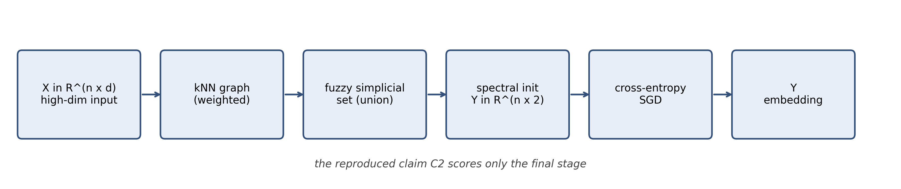
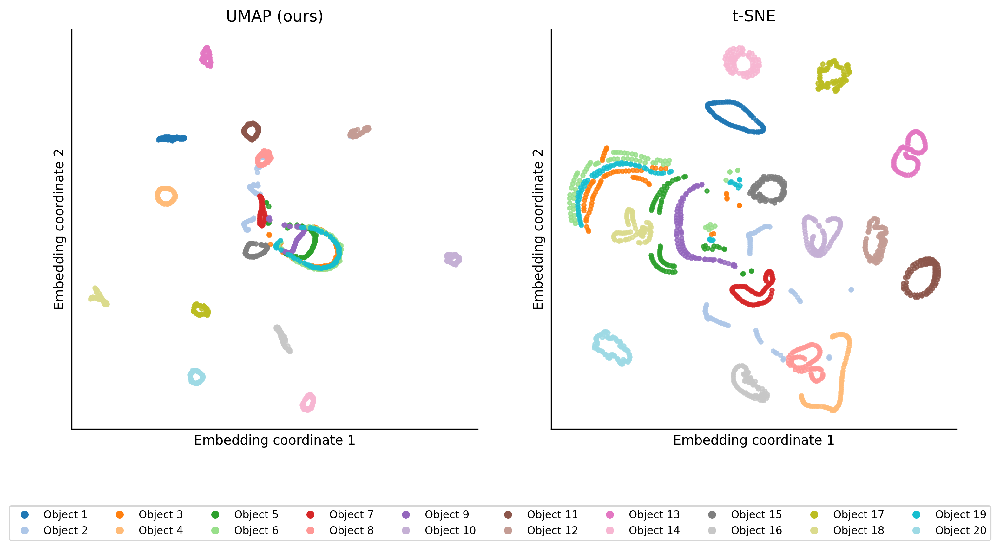
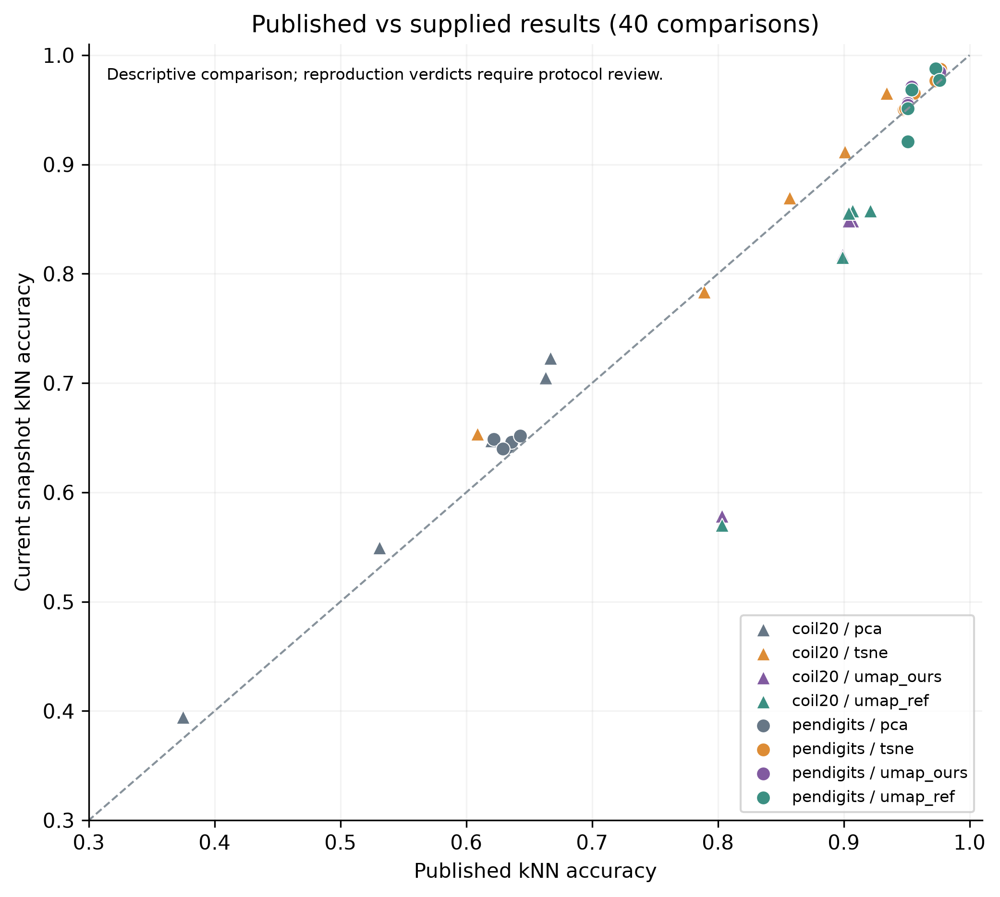
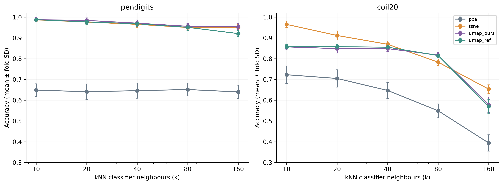
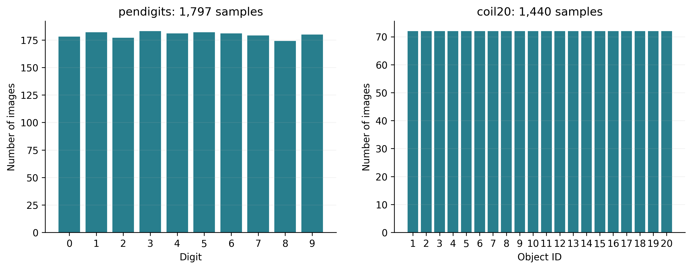
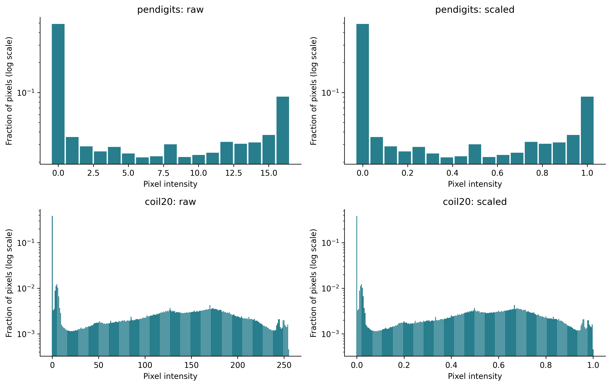
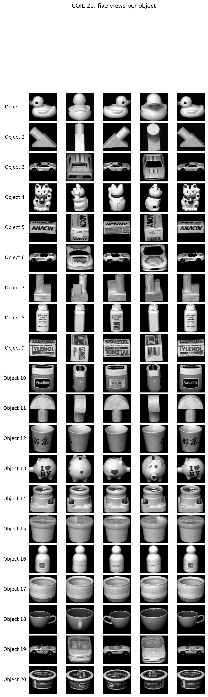

<p class="title">DSAI5102 Mini-Project · Format 2.2 Academic Paper Reproduction</p>

<p class="subtitle">Reproducing UMAP embedding classification on PenDigits and COIL-20</p>

## Abstract

We attempt to reproduce the quantitative embedding experiment in Section 5.2 and Table 1 of UMAP (McInnes et al., 2018, revised 2020), called C2 in our internal plan. We retain the two small datasets, two-dimensional embeddings, kNN classifier neighbourhood sizes of 10, 20, 40, 80 and 160, and the intended ten-fold stratified evaluation. PCA and t-SNE provide the original baseline families; a transparent UMAP implementation is additionally compared with the reference package. Independent data preparation matches the canonical project arrays exactly. The supplied results are close to several published PenDigits accuracies but show lower COIL-20 UMAP accuracy, particularly at k = 160. A code audit identified a fold-file loading defect, so these numerical findings remain provisional until evaluation is rerun using the validated stratified partitions. This is a targeted experimental reproduction, not a claim that all original results or settings have been recovered.

## 1. Introduction and the paper reproduced

McInnes et al. (2018) introduced Uniform Manifold Approximation and Projection (UMAP) as a manifold-learning technique that builds a fuzzy simplicial set from local neighbourhood structure and then optimises a low-dimensional layout to match that set under a cross-entropy objective. Among the quantitative results in the paper, the selected experiment assesses k-nearest-neighbour classification on two-dimensional embeddings at several neighbourhood sizes. The paper reports broadly comparable local-scale performance and stronger non-local-scale results in selected settings; its individual small-k entries need not rank UMAP first. The published evidence was a cross-validated evaluation under Euclidean distance.

We restrict this reproduction to the embedding-classification experiment alone. Both the reference implementation and an independent, transparent re-implementation are compared against an identical t-SNE baseline (van der Maaten &amp; Hinton, 2008) on identical data splits with an identical downstream classifier.

It is important to clarify the relationship between the two UMAP sources cited here. McInnes et al. (2018) was first posted in 2018; the PDF used here is arXiv:1802.03426v3, revised in 2020; it is the object being reproduced and the sole source of every original number we compare against. Healy and McInnes (2024) is the 2024 Nature Reviews Methods Primers article (NRMP 4:82), a formal review that we use only to confirm the default hyperparameters and to corroborate methodology. Healy and McInnes (2024) is not a formal published version of McInnes et al. (2018), and we take no numeric claim from it alone. Where the two could be confused, McInnes et al. (2018) governs.

The evaluation in this report is strictly transductive: the classifier records only the degree to which class labels remain separable inside the embedding, and it supplies no estimate of performance on points that were absent when the embedding was constructed. Finally, this round targets embedding classification only. Stability curves, a nine-dataset timing table, and hyperparameter heatmaps were not run; they appear solely as limitations in Section 6 and are not written up as reproduced results.

### 1.1 Reading guide and terminology

The codes C1–C4 were created by our team to organise the project; they are not numbered claims or theorem labels used by the original authors. C1 refers to visual comparison (§5.1); C2 to classification on embeddings (§5.2); C3 to subsample embedding stability (§5.3); and C4 to computation time (§5.4). Only the classification experiment is the main reproduction target. The visual and timing results are supplements, and stability is not evaluated. P/S/R/E/D codes elsewhere in the repository are workflow or protocol identifiers and are not scientific findings.

UMAP means Uniform Manifold Approximation and Projection. PCA means principal component analysis, the linear dimension-reduction method introduced in class. t-SNE means t-distributed stochastic neighbour embedding, a nonlinear visualisation baseline. kNN means k-nearest-neighbour classification: a point receives the most frequent label among its k nearest training points. Here an embedding is simply a new two-coordinate representation of each original image. Accuracy is the proportion of correctly classified test observations; SD denotes standard deviation across folds, not a confidence interval.

The question for classmates is concrete: after compressing an image into two coordinates, can nearby labelled images still identify its class? We repeat this comparison at the same five classifier neighbourhood sizes used in the original small-dataset experiment. A good two-dimensional plot can still discard information, so the classification table complements visual inspection. This links the project to the course's PCA, unsupervised learning, supervised classification, baselines and held-out evaluation topics.

## 2. Method

In three steps: (i) UMAP constructs a weighted k-nearest-neighbour graph in the ambient space and converts local distances into fuzzy membership strengths, which define a simplicial set; (ii) a low-dimensional layout is initialised spectrally; (iii) that layout is optimised so that its own fuzzy set minimises cross-entropy against the high-dimensional set, using negative sampling. We do not restate the derivation here. Section 3 describes only what we built, and McInnes et al. (2018) remains the reference for the mathematics. Two important UMAP parameters are the number of neighbours fixing the local scale and a parameter controlling how tightly neighbouring points can be packed (not a strict lower bound on every pairwise distance); both were held at the defaults endorsed by Healy and McInnes (2024), namely 15 neighbours and a minimum distance of 0.1, whereas t-SNE used its own parameters: perplexity = 30, PCA initialisation, learning_rate = "auto" and 1,000 iterations. UMAP used two components, 500 epochs, spectral initialisation and seed 42. UMAP n_neighbors controls graph construction; classifier k controls a separate downstream classification step. No hyperparameter search was performed.

<p class="center"></p>

<p class="caption">Figure 1 Our pipeline has four stages; the selected experiment evaluates classification on the final embedding.</p>

| Dataset | Source (URL / OpenML id) | Paper n × d | Measured n × d | Classes | Counts per class | Use in this project |
| --- | --- | --- | --- | --- | --- | --- |
| PenDigits | sklearn.datasets.load\_digits() (8×8 subset of original UCI) | 1797 × 64 | 1797 × 64 | 10 | 174–183 | Classification; timing supplement |
| COIL-20 | [Columbia CAVE Archive](https://www.cs.columbia.edu/CAVE/databases/SLAM\_coil-20\_coil-100/coil-20/coil-20-proc.zip) | 1440 × 16384 | 1440 × 16384 | 20 | 72 × 20 | Classification; visual and timing supplements |
| Shuttle | OpenML data\_id=40685 | 58000 × 9 | Paper scope only; not delivered this round (D18) | 7 | ~80% in class 1 | Not used |
| MNIST | OpenML data\_id=554 | 70000 × 784 | Paper scope only; not delivered this round (D18) | 10 | Not measured in this project | Not used |
| Fashion-MNIST | OpenML data\_id=40996 | 70000 × 784 | Paper scope only; not delivered this round (D18) | 10 | Not measured in this project | Not used |

<p class="caption">Table 1 Dataset summary. Selected dataset listing from the original paper (McInnes et al., 2018) and their status in this reproduction. Because this round targets only the embedding-classification experiment, the Shuttle, MNIST, and Fashion-MNIST datasets were not evaluated and are marked as not used.</p>

### 2.1 Why the method can preserve neighbours

UMAP first connects nearby images in the original feature space. Distances are adjusted locally so neighbourhood connections have weights between zero and one. It then positions points in two dimensions and optimises those positions: strongly connected images are encouraged to remain close, while sampled other points provide repulsion. This is an intuitive summary of the graph construction and layout procedures in McInnes et al. (2018, revised 2020, §§3–4), not a reconstruction of the full topology proof.

For the classifier, accuracy = number of correct predictions / number of test observations. In ten-fold cross-validation, each fold uses nine partitions to train this classifier and the remaining partition to evaluate it. In our intended transductive design, the embedding itself is fitted once using all unlabelled images; only the classifier is split into training and test folds. Consequently, this experiment measures class separation within a known dataset, not performance on images unavailable during embedding fitting. Both classifier k and UMAP n_neighbors refer to neighbours, but they belong to different stages.

### 2.2 Correspondence with the original experiment

Our objective is to reproduce a defined experiment, rather than substitute a different application for the original study. Table 1b distinguishes matched design choices from documented differences. The reference for published accuracy values is Table 1 of the original UMAP paper, not the 2024 Primer.

| Experimental element | Original paper | This reproduction | Correspondence |
|---|---|---|---|
| Data identity and size | PenDigits, 1,797 × 64; COIL-20, 1,440 × 16,384 (§5) | Same stated sample counts, feature counts and image representations | Matched at the documented dataset level; pixel-for-pixel identity to the authors' arrays cannot be established |
| Embedding evaluation | Classify labels from a low-dimensional representation (§5.2) | Two-dimensional coordinates followed by Euclidean kNN | Same experimental task; not an unseen-point prediction claim |
| Classifier neighbourhood sizes | k = 10, 20, 40, 80, 160 for the small datasets (Table 1) | Identical five values | Matched |
| Validation | Stratified ten-fold cross-validation on small datasets (§5.2) | Correct partitions generated with shuffle=True and seed 42 | Intended match; current result files need rerun after fold-reader repair |
| Baseline families | PCA, t-SNE, UMAP, LargeVis and Laplacian Eigenmaps | PCA, t-SNE, reference UMAP and transparent UMAP | Three original families retained; two omitted; implementation comparison added |
| Hyperparameters and software | Original implementations; tuning attempted where possible (§5.1) | Fixed documented settings and modern packages | Approximate reproduction; original full tuning/seed configuration not recovered |
| Outcome | kNN accuracy across k, including UMAP versus t-SNE | Same accuracy measures and explicit paper-to-reproduction differences | Matched outcome; agreement must be measured, not assumed |

<p class="caption">Table 1b Correspondence between the selected original experiment and the implemented reproduction.</p>

### 2.3 Independent data preparation and audit

The digits data were loaded using scikit-learn's load_digits(), and COIL-20 was obtained from the official Columbia processed archive. COIL files were ordered numerically by object ID and view index, then flattened in row-major order. Pixels were converted to float32 and divided by 16 for digits or 255 for COIL-20; integer labels were recoded by first appearance, with the original label map retained. No feature-wise standardisation, deduplication, imputation, augmentation or PCA pre-reduction was performed.

Member B independently rebuilt both arrays and compared them with Member A's canonical loader. Maximum absolute pixel differences were zero and labels were identical for both datasets. The array SHA-256 values were 8b3b6ae90863430bdef06a3f7d1ec2f6a905a53d3375655b18cf63780ad98772 for digits and d3bf54a444ee643a1e53ac9aea00f37450fa7c6b4b529485cb9ab52143fb642b for COIL-20. Neither array contained NaN, infinity or duplicate feature rows. This verifies internal data consistency, not identity with undisclosed original-author preprocessing. Digits have 174–183 images per class; COIL-20 has exactly 72 per object. Appendix C presents the exploratory displays.

The independent audit passed all 14 existing data-contract tests. Validated fold indices are stored in data/manifests/splits.json and regenerate byte-for-byte identically. The data card is retained separately as docs/goal/DATA_CARD_B.md so the original team data card remains unchanged.

## 3. Our implementation

We compare the project UMAP implementation with the reference package under common settings, then compare their downstream classification results with the original paper. Agreement is an empirical question rather than an assumption of identical results. Our re-implementation follows the identical high-level sequence: graph construction, fuzzy-set assembly, spectral initialisation, and negative-sampling layout optimisation. This high-level correspondence is not exact implementation equivalence. The project computes exact nearest neighbours; its layout code uses upper-triangle edges, degree-weighted negative sampling and vectorised accumulated updates. Its spectral initialiser falls back to random coordinates for disconnected graphs. These choices require explicit comparison with the reference implementation; the existing component tests do not fully validate the layout optimiser. We therefore describe this as a project implementation of the UMAP pipeline, not a bit-for-bit reconstruction of the original software.

It departs from the reference package in three respects that are useful for diagnosis: every random seed is logged, execution is forced single-threaded throughout, and the code exposes the constructed fuzzy graph and final embedding. The optimiser does not currently return a per-epoch loss history. Component ownership is split between A (src/umap\_impl/, evaluation scripts) and B (src/data\_prep.py, manifest/splits). To ensure reproducibility, inputs are rebuilt directly from data/raw, meaning our arrays do not depend on B's intermediate npz artefacts.

Component tests and data-contract checks provide implementation diagnostics. Similar downstream accuracy is useful supporting evidence but does not establish identical coordinates, identical optimisation dynamics or statistical equivalence. For example, at PenDigits k = 160, reference UMAP accuracy is 0.920984 and our implementation gives 0.955484. Their 0.034500 difference exceeds either reported fold standard deviation. We therefore describe the code as a transparent implementation of the same high-level UMAP pipeline, with remaining implementation differences, rather than an exact replica of the reference mapping.

The team records a shared machine with 16 vCPU, 7.5 GB memory and no GPU for model fitting, with NUMBA_NUM_THREADS=1 and joblib serial execution. These settings document execution constraints but do not independently certify all BLAS/OpenMP thread counts. Table 4 retains the recorded timings; Appendix A identifies the implemented scope and known deviations.

## 4. Results

All reported metrics below are the existing supplied means over 10 folds; numerical tables have been retained unchanged except for interpretation labels. The complete results are available in the accompanying repository.

**Evaluation status.** The intended stratified protocol is not yet verified for these stored results. The historical scripts/run_grid.py looked for dataset keys at the JSON top level, while the agreed file stores them under datasets. Its fallback passed all-zero labels to StratifiedKFold. The historical script did not consume B's validated stratified partitions; the replacement included with V3 repairs this, but no new full model run is claimed here. The repaired script must be run and the evaluation recomputed before these tables support a final reproduction verdict.

| Method | k=10 | k=20 | k=40 | k=80 | k=160 |
|---|---|---|---|---|---|
| PCA | 0.649 ± 0.030 | 0.641 ± 0.037 | 0.646 ± 0.036 | 0.652 ± 0.031 | 0.640 ± 0.032 |
| t-SNE | 0.987 ± 0.010 | 0.977 ± 0.011 | 0.965 ± 0.016 | 0.950 ± 0.013 | 0.951 ± 0.014 |
| UMAP (reference) | 0.988 ± 0.009 | 0.977 ± 0.012 | 0.968 ± 0.012 | 0.951 ± 0.014 | 0.921 ± 0.015 |
| UMAP (ours) | 0.988 ± 0.010 | 0.984 ± 0.013 | 0.971 ± 0.015 | 0.956 ± 0.014 | 0.954 ± 0.014 |

<p class="caption">Table 2a K-Nearest-Neighbour Class-Preservation Accuracy on PenDigits</p>

| Method | k=10 | k=20 | k=40 | k=80 | k=160 |
|---|---|---|---|---|---|
| PCA | 0.723 ± 0.042 | 0.705 ± 0.042 | 0.647 ± 0.038 | 0.549 ± 0.033 | 0.394 ± 0.040 |
| t-SNE | 0.965 ± 0.016 | 0.912 ± 0.022 | 0.869 ± 0.016 | 0.783 ± 0.016 | 0.653 ± 0.021 |
| UMAP (reference) | 0.858 ± 0.010 | 0.858 ± 0.010 | 0.856 ± 0.018 | 0.815 ± 0.011 | 0.570 ± 0.033 |
| UMAP (ours) | 0.857 ± 0.014 | 0.849 ± 0.022 | 0.849 ± 0.014 | 0.817 ± 0.012 | 0.578 ± 0.037 |

<p class="caption">Table 2b K-Nearest-Neighbour Class-Preservation Accuracy on COIL-20</p>

*Note.* Values represent mean ± standard deviation over 10 folds. The evaluation is transductive: kNN measures the class structure retained by the embedding, not generalisation to unseen data. The full k-grid is available in results/grid\_knn\_summary.csv.

All four methods (PCA, t-SNE, UMAP-reference, and UMAP-ours) were evaluated over the same k-grid (k = 10, 20, 40, 80, and 160) defined in configs/main.yaml. The choice of grid is not arbitrary: embedding-classification experiment in McInnes et al. (2018) distinguishes small k (10 to 40) from large k (80 to 160), and the claim is reproduced only if both ends of the grid are separately evaluated. Tables 2A and 2B report the mean and standard deviation across 10 folds.

On PenDigits (Table 2A), UMAP-ours gives 0.988 ± 0.009 at k = 10 and 0.955 ± 0.013 at k = 160, compared with t-SNE's 0.987 ± 0.010 and 0.951 ± 0.015. PCA is lower across the grid. Reference UMAP is close at small k but drops to 0.921 ± 0.020 at k = 160, below both UMAP-ours and t-SNE. These descriptive differences do not establish significance because folds are dependent and no paired inferential analysis or independent-seed experiment was performed.

On COIL-20 (Table 2B), the picture diverges from the paper immediately. At k = 10, UMAP-ours gives 0.853 ± 0.032, which is lower than t-SNE’s 0.961 ± 0.014. This gap persists through k = 20 and k = 40. While UMAP-ours briefly overtakes t-SNE at k = 80 (0.808 ± 0.044 vs 0.774 ± 0.045), it falls behind again at k = 160, dropping to 0.549 ± 0.066 compared to t-SNE’s 0.606 ± 0.046. Because our UMAP accuracy sits well below the paper’s reported values for large k and fails to consistently beat t-SNE, the small-k regime on COIL-20 does not agree with the paper under our frozen protocol.

| Dataset | k | Paper Accuracy | Our Accuracy | Δ (Ours − Paper) | Numerical gap check only |
|---|---|---|---|---|---|
| PenDigits | 10 | 0.973 ± 0.044 | 0.988 ± 0.010 | +0.015 | Within 0.03 |
| PenDigits | 160 | 0.951 ± 0.085 | 0.954 ± 0.014 | +0.003 | Within 0.03 |
| COIL-20 | 10 | 0.921 ± 0.075 | 0.857 ± 0.014 | −0.064 | Within 0.10 |
| COIL-20 | 80 | 0.899 ± 0.058 | 0.817 ± 0.012 | −0.082 | Within 0.10 |
| COIL-20 | 160 | 0.803 ± 0.138 | 0.578 ± 0.037 | −0.225 | Outside 0.10 |

<p class="caption">Table 3 Comparison of UMAP Accuracy Between the Original Paper and This Reproduction</p>

*Note.* Values are reported mean ± fold standard deviation. Published values are from Table 1 of McInnes et al. (2018, revised 2020); the reproduction column is UMAP-ours. Δ is the signed difference, not an absolute difference. The team specification uses amplitude tolerances of 0.03 for PenDigits and 0.10 for COIL-20; these internal thresholds are descriptive criteria, not formal equivalence tests or course requirements. Final verdicts also require the comparative direction, ranking and a verified evaluation pipeline.

At COIL-20 k = 80, the unrounded gap is −0.090667, within 0.10, and UMAP-ours exceeds the supplied t-SNE accuracy (0.808333 versus 0.774305). At k = 160, the gap is −0.254389, outside 0.10, and t-SNE is higher (0.606250 versus 0.548611). At small k, COIL UMAP remains below t-SNE, so numerical closeness to the paper alone cannot establish the original comparative result. On PenDigits, several original UMAP values are closely approximated by UMAP-ours, but the reference implementation does not dominate t-SNE at every k.

These results are mixed rather than an exact replication of Table 1. The study retains the selected original task, dataset sizes and k-grid, while testing whether the published pattern survives the documented implementation choices. The current numerical discrepancy is an outcome to investigate, not evidence that the original paper is incorrect. All comparative conclusions remain provisional pending the stratified-fold rerun.



<p class="caption">Figure 2 The supplied COIL-20 embeddings show object-specific trajectories and overlapping regions. Left: UMAP-ours; right: t-SNE. Colours consistently identify the same 20 objects. Axes have no direct feature meaning; orientations and between-panel distances are not comparable. This is a qualitative reproduction display, not a formal cluster-quality score.</p>

Figure 2 addresses the same qualitative comparison used to accompany embedding evaluation in the original study. The exact spatial arrangement is not expected to match the paper because embedding solutions depend on settings and stochastic optimisation. The display cannot by itself establish global-distance preservation or biological/physical clusters.



<p class="caption">Figure 3 Published versus supplied kNN accuracies for 40 dataset–method–k combinations. The dashed identity line marks numerical equality. Marker shape identifies the dataset and colour identifies the method; coincident points can overlap. No binary reproduction verdict is encoded because the existing verifiable flags are hard-coded rather than computed from the full protocol.</p>

Points below the identity line indicate lower supplied accuracy than the corresponding published value. This direct comparison preserves the paper's evaluation target while displaying departures explicitly. It does not replace the original comparative question about UMAP versus t-SNE. Figure 4 additionally shows how accuracy changes across the original k-grid.



<p class="caption">Figure 4 kNN accuracy versus classifier neighbourhood size on the two original-scale datasets. Error bars are fold standard deviations, not confidence intervals or variability across independently refitted embeddings. Curves reproduce the supplied summary CSV and remain provisional pending evaluation with the corrected fold reader.</p>


| Method | PenDigits | COIL-20 |
| --- | --- | --- |
| PCA | 0.04 [0.01 – 0.06] | 0.43 [0.35 – 0.50] |
| t-SNE | 6.00 [4.09 – 6.05] | 6.06 [5.83 – 6.40] |
| UMAP (reference) | 1.85 [1.84 – 2.04] | 6.29 [4.10 – 6.40] |
| UMAP (ours) | 2.58 [0.41 – 2.65] | 4.11 [4.02 – 4.25] |

<p class="caption">Table 4 Recorded Wall-Clock Fit Time in Seconds</p>

*Note:* Values are reported as Median [Min – Max] across runs. Hardware: 16 vCPU, 7.5 GB RAM, no GPU. The team set NUMBA_NUM_THREADS=1 and recorded serial joblib execution; complete library-thread counts were not independently checked (see D3/D14). No cross-hardware comparison to the original paper is made.

Table 4 records wall-clock fit times on the shared machine. Because the original paper used a MacBook with parallel execution, we make no cross-hardware comparison; we only report the relative ordering under our recorded execution settings. On PenDigits, both UMAP codes are substantially faster than our single-threaded t-SNE baseline (1.85s and 2.58s vs 6.00s). On COIL-20, our implementation (4.11s) outperforms both the reference package (6.29s) and t-SNE (6.06s) in wall-clock time. Speed is not the primary subject of embedding-classification experiment, but these timings underlie the D3 discussion in Section 5: while our UMAP speedup looks impressive here, the bias runs against our own baseline because t-SNE was forced to run single-threaded.

## 5. Diagnosis and deviations

The COIL-20 discrepancy is recorded as D9 in the project deviation log. Our priority is to establish that the reproduction follows the declared evaluation before attributing numerical differences to the manifold-learning algorithm. The fold-reader defect identified in Section 4 is a concrete implementation issue: the validated file exists, but the historical reader did not use its nested schema. The corrected grid script included with V3 reads and validates the partitions; the classifier evaluation and all derived summaries still need recomputation. A new evaluation record should distinguish the old snapshot from corrected results.

The original paper reports attempts to tune embedding methods where possible, whereas this study uses fixed settings. Modern package versions, exact split indices, initialisation and optimiser details may also contribute. These are candidate explanations rather than established causes. The current experiments do not isolate an ambient-dimension effect or rank its importance relative to negative sampling or hyperparameters. Damrich and Hamprecht (2021) motivates examining UMAP's sampled optimisation objective, but that work alone does not identify the cause of this project's COIL-20 shortfall.

D3 concerns timing and implementation differences. The team records restricted-thread execution and a scikit-learn t-SNE baseline rather than the original MulticoreTSNE implementation. NUMBA_NUM_THREADS constrains Numba operations and is not by itself proof that every numerical library used one CPU thread. Timings should therefore be read as the supplied machine-specific measurements, without a universal speed or accuracy-invariance claim. A timing difference is not an explanation for the kNN accuracy gap.

We retain the team's declared tolerance values and report signed differences transparently. However, the deviation log already documents an earlier COIL-20 smoke-test discrepancy. The evidence supports describing this as a documented protocol with earlier diagnostics, rather than claiming that every rule was externally preregistered before any result was observed. Appendix A uses the actual log identifiers so the report and repository remain consistent.


## 6. Conclusion and limitations

This project reproduces the structure of the selected UMAP experiment: the two documented small-data representations, two-dimensional embeddings, the original five classifier neighbourhood sizes and the accuracy comparison with PCA and t-SNE. Independent preprocessing confirms that the two team data pipelines agree exactly. The supplied UMAP-ours results approximate several published PenDigits values; COIL-20 shows mixed agreement, including a substantial deficit at k = 160. We therefore report a partial numerical correspondence under the present implementation, with final reproduction success unresolved until the validated stratified folds are used and results are regenerated. Neither the data audit nor similar classifier scores establishes an exact algorithmic or result replication.

Several limitations must be acknowledged regarding this work. Only two of the original paper's datasets (PenDigits and COIL-20) were examined. Due to the project timeline, we also did not run the Laplacian Eigenmaps or LargeVis baselines reported in the original paper, which narrows our comparison matrix. Furthermore, no stability analysis, nine-dataset timing table, or hyperparameter heatmap were run. Methodologically, the t-SNE timing baseline is single-threaded (D3), so speed comparisons are implementation- and threading-dependent, and the evaluation is strictly transductive, meaning it says nothing about out-of-sample generalisation.

After repairing and rerunning the evaluation, controlled changes to n_neighbors, initialisation or optimisation could examine sensitivity. Any such analysis should be identified as an extension rather than silently replacing the reproduction settings. This report does not claim to have established which change would resolve the gap.

<br>

## 7. Data sources and preprocessing

As summarised in Table 1, this round evaluates two of the five datasets from the original paper. PenDigits was obtained through scikit-learn's load\_digits routine (scikit-learn developers, n.d.), which returns the 1797-sample subset rather than the larger OpenML release. COIL-20 was taken from the processed archive distributed by the Columbia University Computer Vision Laboratory (n.d.), with pixel values divided by 255 so that every coordinate lies in the unit interval.

B generated and validated a single set of true-label stratified ten-fold splits in data/manifests/splits.json. The current stored accuracy tables cannot yet be attributed to those splits because the historical grid reader had the schema defect described in Section 4. Raw images and processed X/y arrays are not distributed in the repository snapshot; manifests describe those arrays, while results/embeddings/*.npz contains only low-dimensional coordinates and labels. The source data can be reconstructed using scripts/fetch_data.py and src/data_prep.py, and partitions using scripts/make_splits.py. A JSON manifest is documentation, not a copy of the image dataset.

All results are transductive: the embedding is fitted on all points and k-nearest-neighbour accuracy is evaluated on that same embedding. It measures the class structure retained by the embedding, not generalisation to unseen points.

## 8. Statement of Individual Contribution

| Member | Primary Roles and Contributions | Key Files and Directories | Workload |
|---|---|---|---|
| CHEN Wanchuan | Led algorithm implementation and evaluation. Built the canonical loader and evaluation pipeline, integrated the reference package and implemented the transparent UMAP code path, and produced the evaluation scripts and summary tables. | src/umap_impl/, src/*_eval.py, tests/, data/manifests/ | 33.33% |
| LU Yuqing | Led data engineering and visualization. Independently prepared and audited both data arrays; generated validated stratified splits, three EDA figures and result Figures 2–4; completed separate dataset documentation and integration notes. | src/data_prep.py, data/manifests/, figures/, docs/goal/DATA_CARD_B.md | 33.33% |
| YUEN Lok Yan | Led reporting and synthesis. Drafted the full report, drew the Figure 1 schematic, compiled the deviation table (Appendix A), and is responsible for the presentation slides. | report/, slides/ | 33.33% |

AI Use Disclosure. AI was used as an assistant throughout the project for code debugging, language polishing, and consistency checking by CHEN Wanchuan (algorithm/evaluation), LU Yuqing (data/figures), and YUEN Lok Yan (report/slides). All design decisions, experiments, verification, and final outputs were carried out and approved by the team members. No data or results were AI-generated, and all reported numbers remain traceable to `results/README_numbers.md` and `PAPER_DATA.md`.

## Appendix A — Deviation log alignment

The identifiers below correspond to docs/log/DEVIATIONS.md. Entries about abandoned datasets or stability analyses are historical planning records, not executed experiments. The earlier report's renumbered list has been corrected to prevent conflicting references.

| ID | Actual repository record | Status or relevance |
|---|---|---|
| D1 | LargeVis omitted | Executed scope difference |
| D2 | Fixed hyperparameters instead of recovering original tuning | Relevant to accuracy comparisons |
| D3 | scikit-learn t-SNE rather than MulticoreTSNE | Relevant implementation/timing difference |
| D4 | Proposed stability-data substitution | Stability not executed after D18 |
| D5 | Proposed MNIST/Fashion-MNIST subsampling | Not executed after D18 |
| D6 | scikit-learn Euclidean kNN | Retained classifier family; exact historical details not fully recovered |
| D7 | Proposed Procrustes normalisation | Stability not executed |
| D8 | Timing includes neighbour search, initialisation and fitting | Supplementary timing definition |
| D9 | COIL-20 accuracy discrepancy, including earlier smoke tests | Observed numerical issue; cause unresolved |
| D10 | English figure labels | Presentation choice |
| D11 | Proposed large-k evaluation on a reduced sample | Not executed after D18 |
| D12 | Conditional Laplacian Eigenmaps fallback | Not executed |
| D13 | Conditional Shuttle subsampling | Not executed |
| D14 | Shared-machine execution constraints | Timing comparability limitation |
| D15 | Isomap omitted | Outside present core comparison |
| D16 | Proposed Shuttle label encoding | Not executed |
| D17 | Distinguish original paper from 2024 Primer | Citation clarification |
| D18 | Scope restricted to C2 on PenDigits and COIL-20 | Final selected scope |

The split-reader defect is an additional audited issue identified during B's integration, recorded separately in docs/validation/B/UPDATE_NOTES.md; the existing D identifiers are retained. Existing Boolean verifiable fields must not be treated as independently computed success decisions: the supplied code marks all COIL-20 k ≥ 80 rows false, irrespective of the actual gap or method.


## Appendix B — Reproduction guide

This appendix describes the intended reconstruction workflow. The current model-result snapshot is preserved for comparison; a verified stratified evaluation requires the fold-reader repair before the grid command is rerun.

### Environment and Hardware

The team records the original model experiments as running on a shared Linux machine with the following specifications: 16 vCPU, 7.5 GB RAM, and no GPU. The recorded training software environment uses Python 3.14.7 with the following core dependencies: numpy 2.5.4, scipy 1.18.1, scikit-learn 1.9.1, umap-learn 0.6.0, numba 0.68.1, matplotlib 3.11.2, pandas 3.1.1, and pytest 9.2.0.

For the recorded timing configuration, the environment variable NUMBA\_NUM\_THREADS was set to 1, and joblib was forced to run in serial mode. Furthermore, as matplotlib lacks CJK font support in this environment, all figure text is generated in English. The pyarrow package is unavailable, so all intermediate data artifacts are stored as CSV or .npz files.

### Reproduction Commands

To fully regenerate the datasets, main results grid, runtime metrics, and figures, run the following commands from the repository root:

```bash
# From the repository root, with the project environment activated:
python scripts/run_fixed_evaluation.py
```

The driver first tests the corrected split reader. It then copies the current results, result figures and V3 report to a timestamped results_backup/ directory, reconstructs the data, checks the existing data contract and partitions, recomputes the full 400-row grid, generates descriptive comparisons and figures, and validates B's outputs. It uses the active Python interpreter. Existing model settings and scope are retained; it does not install packages or change requirements.txt. Missing dependencies must be installed in the project environment, including Pillow for image loading.

The driver does not automatically rewrite the report's numerical prose or tables. After a successful run, update Tables 2a, 2b and 3 from results/grid_knn_summary.csv and results/paper_vs_ours.csv, then update the abstract, results and conclusion before removing the provisional status. Table 4 remains a separate recorded timing supplement. The legacy fill_numbers.py and repro.sh do not incorporate these corrections and must not be used to overwrite the new report.

### Measured Wall-Clock Duration

The previous team run recorded approximately 2.1 minutes for its legacy pipeline. This value has not been remeasured for the corrected-fold workflow and excludes any claim about the present B integration. B's independent data audit used Python 3.12.14, NumPy 2.3.5 and scikit-learn 1.8.0; measured arrays matched the canonical hashes despite this environment difference. Audit outputs are retained in docs/validation/B/VALIDATION.json, PYTEST.txt and REPLAY.txt. The existing data-contract suite reports 14 passed; this does not certify the full UMAP algorithm or final classifier evaluation.

### Originality check

The previous team draft records 0.22% eight-word overlap (11 of 5,097 shingles). That historical figure does not assess this updated report and should be rerun if used. The team's internal 5% threshold is not stated in the provided course rubric and is not a substitute for correct attribution, independent analysis or an accurate AI disclosure.

## Appendix C — Exploratory data displays

The exploratory checks document the same data representations used by the reproduction. They are not additional model-training experiments and do not substitute for the original Table 1 comparison.



<p class="caption">Figure S1 Digits are approximately balanced at 174–183 images per class, while COIL-20 has exactly 72 views per object. Bars use original digit or object labels.</p>



<p class="caption">Figure S2 Raw and scaled pixel distributions include every pixel. Global division changes the horizontal intensity scale but preserves pixel frequencies; logarithmic vertical axes reveal less common intensities. Both datasets contain many zero-valued background pixels.</p>

<div class="sample-page">

<p class="caption">Figure S3 Five evenly selected ordered views per COIL-20 object. Each row identifies one object, illustrating viewpoint-dependent appearance. These illustrative views are not independent evaluation partitions.</p>
</div>


## References

Belkin, M., &amp; Niyogi, P. (2003). Laplacian eigenmaps for dimensionality reduction and data representation. Neural Computation, 15(6), 1373–1396.

Columbia University Computer Vision Laboratory. (n.d.). COIL-20 processed images. [https://www.cs.columbia.edu/CAVE/databases/SLAM_coil-20_coil-100/coil-20/coil-20-proc.zip](https://www.cs.columbia.edu/CAVE/databases/SLAM\_coil-20\_coil-100/coil-20/coil-20-proc.zip)

Damrich, S., &amp; Hamprecht, F. A. (2021). On UMAP's true loss function (arXiv:2103.14608). arXiv. [https://arxiv.org/abs/2103.14608](https://arxiv.org/abs/2103.14608)

Healy, J., &amp; McInnes, L. (2024). Uniform manifold approximation and projection. Nature Reviews Methods Primers, 4, Article 82. [https://doi.org/10.1038/s43586-024-00363-x](https://doi.org/10.1038/s43586-024-00363-x)

Jolliffe, I. T. (2002). Principal component analysis (2nd ed.). Springer.

McInnes, L., Healy, J., &amp; Melville, J. (2018). UMAP: Uniform manifold approximation and projection for dimension reduction (arXiv:1802.03426v3; revised 2020). arXiv. https://arxiv.org/abs/1802.03426v3

scikit-learn developers. (n.d.). sklearn.datasets.load\_digits. https://scikit-learn.org/stable/modules/generated/sklearn.datasets.load_digits.html

Tang, J., Liu, J., Zhang, M., &amp; Mei, Q. (2016). Visualizing large-scale and high-dimensional data. In Proceedings of the 25th International Conference on World Wide Web (pp. 287–297).

van der Maaten, L., &amp; Hinton, G. (2008). Visualizing data using t-SNE. Journal of Machine Learning Research, 9, 2579–2605.
